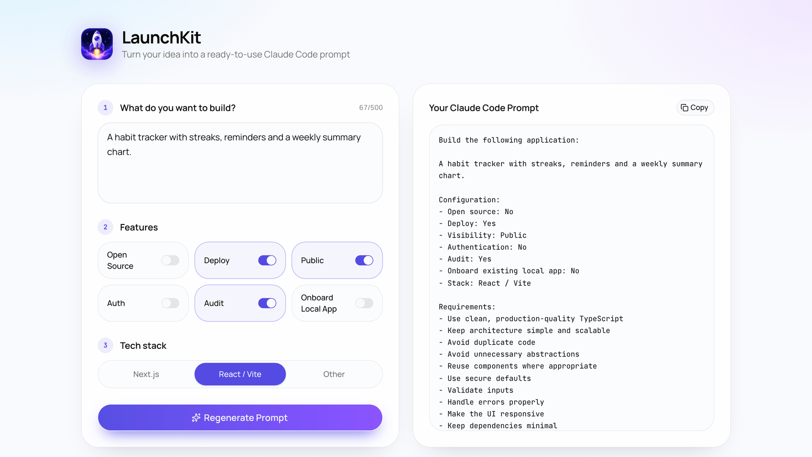
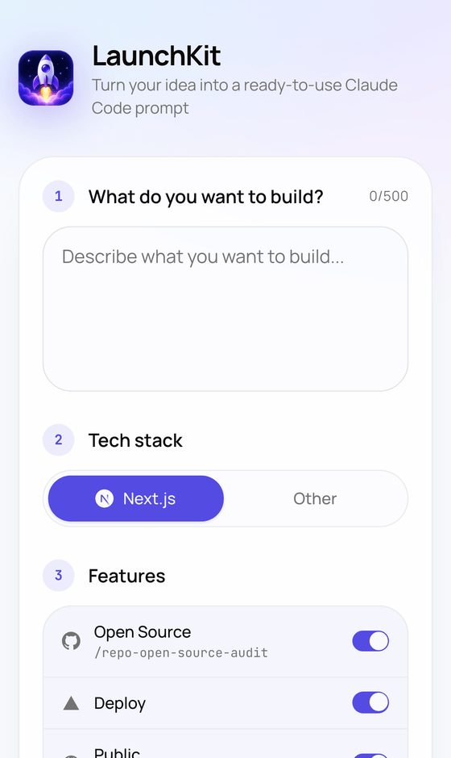
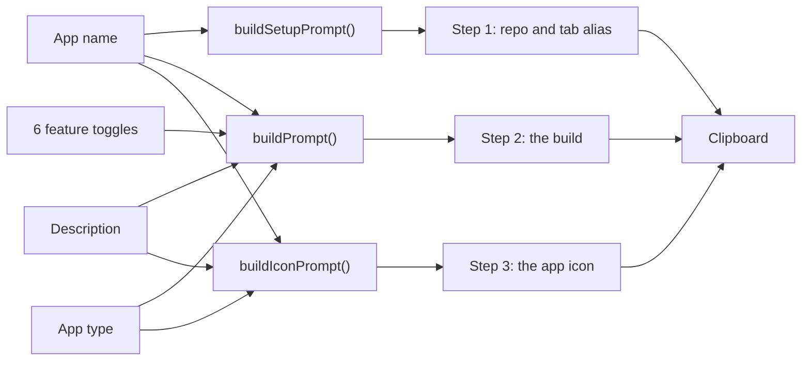

# LaunchKit

Describe an app in a sentence, flip a few toggles, and get a structured Claude Code prompt you can paste straight into a terminal.



[](LICENSE)
[](https://github.com/bunlongheng/launchkit/actions/workflows/ci.yml)


## Contents

- [Why](#why)
- [Features](#features)
- [Architecture](#architecture)
- [Design decisions and trade-offs](#design-decisions-and-trade-offs)
- [Tech stack](#tech-stack)
- [Quick start](#quick-start)
- [Configuration](#configuration)
- [Project layout](#project-layout)
- [Tests](#tests)
- [Trademarks](#trademarks)
- [License](#license)

## Why

A one-line request like "build me a habit tracker" leaves an agent guessing about
quality bars, deployment, licensing and whether to touch the existing repo. Writing the
full brief by hand every time is tedious and easy to get wrong.

LaunchKit keeps the boilerplate half of that brief in one place. You supply the idea and
the 3 or 4 choices that actually vary; it assembles the rest.

## Features

- Name the app and describe it in up to 4000 characters, with a counter that turns
  amber at the ceiling rather than silently swallowing a long paste. The description
  gets 60% of the form and 24px text, since it is the only field you write prose into.
- A microphone button inside the description box: tap it and talk instead of typing,
  which is how a child gets an idea in. Interim words appear as they are heard and
  settle in place, anything already typed is kept, and the button is not rendered at
  all in a browser without speech recognition.
- On a phone the app type and feature lists start folded behind their own answer -
  the selected type's mark, and the marks of whatever is switched on - so the whole
  form fits on 1 screen. From `md` up both are open and the toggle is not rendered.
- The output comes in 3 copyable steps, laid out as a chevron rail you click or arrow
  through, because an agent cannot move itself into a new terminal tab. Step 1 runs where you are: create the repo, add the shell alias
  derived from the name, open the tab, then stop. Step 2 is the build itself, which
  you paste into that new tab so its token usage lands on that session.
- Step 3 is the app icon, pasted into the same tab once the build is done. It carries
  the house image prompt (one glossy 3D subject on a light gradient, no lettering) and
  says where the finished icon installs for the app type you picked: `app/icon.png` and
  the manifest for a web app, the MV3 manifest icons for an extension, the asset
  catalog for a native app.
- The alias is underscores only, never a dash, since it is used as a shell function
  name. "Ice Creams" becomes `_ice_creams`.
- 6 toggles that each change the prompt in a real way: Open Source, Deploy, Public or
  Private, Audit, Onboard Local App and Auth. 5 of them add their own guidance section.
  Everything ships on except Auth, since far from every app needs a login.
- 4 of those toggles map to a real Claude Code skill, shown on the switch and emitted
  as a numbered run order at the end of the prompt: `/onboard`, `/repo-audit`,
  `/repo-public-audit` and `/repo-open-source-audit`.
- Pick an app type and the stack comes with it: Web App on Next.js, Chrome Extension
  on TypeScript and MV3, TUI on Rust, Native on Swift. Each carries its own mark.
- The output pane stays out of the way until you generate, then reveals below the form
  and scrolls itself into view.
- Read the assembled prompt in a monospace pane and copy it with 1 click.
- Change a setting after generating and the pane flags itself as out of date, so you
  never copy a prompt that no longer matches the form.
- Keyboard and screen reader friendly: the stack selector is a real radiogroup and the
  step rail a real tablist, both with arrow-key navigation, every toggle is a labelled
  switch, and copy results are announced.



## Architecture

3 layers, and the dependency only ever points downward. The page is a server component
that renders 1 stateful client component; that component owns the form state and calls 3
pure functions to turn it into text. There is no server code, no database and no network
call at runtime, so the whole site prerenders to static files.

The output is split because an agent cannot move itself into a new terminal tab. The
name alone drives the setup step; everything drives the build; the name, the idea and
the app type drive the icon.



| Layer | Lives in | Responsibility |
|-------|----------|----------------|
| Page | `app/` | Metadata, fonts, icons, manifest, and the static shell |
| UI | `components/` | Form state, rendering, accessibility |
| Domain | `lib/buildPrompt.ts` | Turning settings into the 2 prompts. Pure, no DOM |

## Design decisions and trade-offs

| Decision | Chosen | Alternative | Why this trade-off | Cost we accept |
|----------|--------|-------------|--------------------|----------------|
| Prompt assembly | A pure function in `lib/` | Build the string inside the component | Testable with `node:test` and no browser | 1 extra module for a small app |
| Rendering | Fully static, no server | An API route that returns the prompt | Nothing to secure, scale or pay for | The rules ship to the client, so they are public |
| Generating | An explicit button | Re-render the prompt on every keystroke | The output is meant to be read and copied, not to flicker | Needs a staleness signal, which the pane provides |
| UI primitives | shadcn on `@base-ui/react` | Hand-rolled switches and radios | Correct ARIA and focus behaviour for free | A build-time dependency |
| Content Security Policy | `script-src 'unsafe-inline'` | A nonce-based policy | A static export cannot run per-request middleware | Accepted because the app renders no user-supplied HTML |

## Tech stack

- Next.js 16 App Router, React 19, TypeScript in strict mode
- Tailwind CSS v4 with shadcn components built on `@base-ui/react`
- `lucide-react` icons, official brand marks from `simple-icons`, Manrope and
  JetBrains Mono via `next/font`
- `node:test` for unit tests, Playwright for the end-to-end flow
- Hosted on Vercel, with GitHub Actions running every check on push

## Quick start

Requires Node 22.6 or newer, since the test runner strips TypeScript types natively.

```bash
git clone https://github.com/bunlongheng/launchkit.git
cd launchkit
npm install
npm run dev
```

Open http://localhost:3046.

## Configuration

| Env var | Default | Purpose |
|---------|---------|---------|
| `NEXT_PUBLIC_SITE_URL` | `https://launchkit-bheng.vercel.app` | Canonical origin for canonical links, Open Graph tags and the web manifest |

Optional. Everything else runs with no configuration at all.

## Project layout

```
app/
  page.tsx              # server component: header plus the builder
  layout.tsx            # fonts, metadata, Open Graph, manifest
  manifest.ts           # web app manifest for home-screen install
  globals.css           # theme tokens and the page entrance animation
  icon.png              # 512 web icon, also the header mark
  apple-icon.png        # 180 touch icon, flattened for the iOS mask
  opengraph-image.jpg   # 1200x630 share card
components/
  AppBuilder.tsx        # the only stateful component
  CollapsibleStep.tsx   # folds a step behind its answer at phone widths
  DictateButton.tsx     # Web Speech dictation for the description
  BrandIcons.tsx        # generated: official GitHub, Vercel, Next.js, Chrome, Rust, Swift marks
  NameField.tsx         # app name, previewing the tab alias it produces
  DescriptionField.tsx  # textarea plus character counter
  FeatureToggles.tsx    # the 6 switches, each with its mark and skill command
  AppTypeSelector.tsx   # 4 app types, each with its mark and implied stack
  PromptPreview.tsx     # chevron step tabs, the active prompt, copy, staleness pill
  StepLabel.tsx         # numbered section heading
  ui/                   # shadcn primitives
lib/
  buildPrompt.ts        # the entire domain: settings in, prompt out
scripts/
  brand-icons.mjs       # regenerates BrandIcons.tsx from simple-icons
tests/
  buildPrompt.test.ts   # unit coverage of the prompt rules
e2e/
  prompt.spec.ts        # generate, copy, staleness, keyboard
```

## Tests

```bash
npm run typecheck   # tsc, sources and tests
npm run lint        # eslint
npm test            # node:test unit suite
npm run test:e2e    # Playwright, boots the dev server itself
```

Point `E2E_BASE_URL` at a deployed URL to run the same end-to-end suite against it.

## Trademarks

The GitHub, Vercel, Next.js, Chrome, Rust and Swift marks are trademarks of their
respective owners. They appear here only to label the technology each option targets,
and their artwork comes from [simple-icons](https://github.com/simple-icons/simple-icons),
which releases it under CC0. Their inclusion implies no affiliation or endorsement.

---

<div align="center">

<a href="https://bunlongheng.com"></a>
<a href="https://www.linkedin.com/in/bunlongheng/"></a>
<a href="https://www.instagram.com/ibunlong/"></a>
<a href="mailto:bheng.code@gmail.com"></a>

<br>

Built by **[Bunlong](https://bunlongheng.com)** &nbsp;&middot;&nbsp; [more apps](https://bunlongheng.com/projects)

</div>
